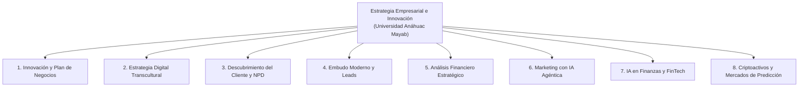

# Estrategia Empresarial & Innovación

Repositorio oficial de presentaciones maestras en español diseñadas para cursos de licenciatura, maestría y posgrado en la **Universidad Anáhuac Mayab** (Mérida, Yucatán, México), desarrolladas e impartidas por el **Dr. J. Christopher Westland**.

Todas las presentaciones han sido desarrolladas bajo estándares académicos y ejecutivos rigurosos, incorporando el **Sistema de Diseño Institucional Anáhuac** (pantalla ancha 16:9, paleta cromática naranja `#FF5900`, antracita `#231F20` y marfil cálido `#FAF8F5`, tipografía Segoe UI, diagramas vectoriales nativos de 300 DPI e infografías personalizadas en cada diapositiva, complementadas con notas pedagógicas del orador para el profesor).

---

## 🗺️ Mapa Curricular y Catálogo Maestro

---

## 📚 Desglose Detallado por Módulo y Archivo

### 1. Innovación Estratégica y Plan de Negocios
Fundamentos de creación de empresas innovadoras basados en la tesis $\text{Innovación} = \text{Invención} + \text{Comercialización}$ (*Global Innovation Management*).

* **[`Innovation_and_Business_Plan_Master_Anahuac_ES.pptx`](./Innovation_and_Business_Plan_Master_Anahuac_ES.pptx)** (28 Diapositivas | 13.3 MB)
  * **Estructura:** Master Deck integral que fusiona los 20 principios teóricos de la innovación estratégica con el workout de 8 pasos del plan de negocios.
  * **Contenido Clave:** La regla de oro del cliente pagador, clasificación de funcionalidades (básicas, diferenciador único, excitadores), apalancamiento en redes logísticas de gigantes tecnológicos (Amazon/Alibaba), las tres curvas maestras de evolución financiera (ingresos, costos variables y fijos), y la transición hacia la empresa viva.

* **[`Innovation_Slides_1-20_Anahuac_ES.pptx`](./Innovation_Slides_1-20_Anahuac_ES.pptx)** (20 Diapositivas | 8.7 MB)
  * **Estructura:** Guía teórica magistral de 20 diapositivas para clases expositivas.
  * **Contenido Clave:** Deconstrucción de fallas clásicas de producto, cómo validar tracción real antes de quemar capital, estructura de capital en startups y mitigación del riesgo operativo.

* **[`Business_Plan_Workout_Anahuac_ES.pptx`](./Business_Plan_Workout_Anahuac_ES.pptx)** (8 Diapositivas | 4.8 MB)
  * **Estructura:** Taller práctico de trabajo en equipo (*Student Workout*).
  * **Contenido Clave:** Matriz de 8 fases que guía al alumno en la definición del cliente objetivo, mapa de dolor, selección de diferenciador, diseño de canales de distribución, unit economics iniciales y presentación ante comités de inversión.

---

### 2. Estrategia Digital Intercultural y Negociaciones Globales
Diseñado para la cátedra de *Casos de Estrategia Internacional* y *Comercio Electrónico Global*.

* **[`Cross_Cultural_Digital_Strategy_Anahuac_ES.pptx`](./Cross_Cultural_Digital_Strategy_Anahuac_ES.pptx)** (40 Diapositivas | 7.7 MB)
  * **Estructura:** 6 bloques pedagógicos diseñados para 5.0 horas de contacto académico:
    1. *Bloque 0 (Diaps 1–2):* Visión estratégica y cronograma maestro.
    2. *Bloque I (Diaps 3–14):* Conferencia 1: Globalización de innovaciones descentralizadas, rieles de pago Web3, el dilema de los dos mercados (utilidad vs. especulación), dimensiones culturales (EE.UU. vs. China vs. LATAM), leyes de Metcalfe vs. Odlyzko, y arbitraje regulatorio transfronterizo.
    3. *Bloque II (Diaps 15–18):* Estudio de Caso 1: "El Dólar sin Fronteras" — Tether (USDT), Strike y la disrupción del corredor de remesas de Western Union en América Latina ($R^2 > 0.88$ con la inflación).
    4. *Bloque III (Diaps 19–20):* Workout Estudiantil 1: Ruptura de supuestos bancarios tradicionales y caja morfológica de Zwicky ($5 \times 5$).
    5. *Bloque IV (Diaps 21–32):* Conferencia 2: Agregación de información y mercados de predicción (Hayek y Shannon), modelos de negocio de Kalshi vs. Polymarket, el problema del oráculo (UMA) y leyes de potencia en trading algorítmico.
    6. *Bloque V y VI (Diaps 33–40):* Estudio de Caso 2 (Elecciones presidenciales y microestructura), Workout 2 y síntesis ejecutiva.

---

### 3. Descubrimiento de Necesidades del Cliente y Desarrollo de Productos (NPD)
Metodologías modernas para evitar el 80% de fracaso en lanzamientos de nuevos productos comerciales.

* **[`Customer_Needs_and_Product_Development_Anahuac_ES.pptx`](./Customer_Needs_and_Product_Development_Anahuac_ES.pptx)** (17 Diapositivas | 3.0 MB)
  * **Estructura:** 4 módulos con redacción clara, concisa y accesible:
    1. *El Paradigma del Cliente (Diaps 1–5):* La trampa demográfica ("Gen Z", "Madres trabajadoras"), por qué falla el desarrollo tradicional tipo *waterfall*, y el producto como un paquete de funcionalidades (*feature bundle*).
    2. *El Viaje del Cliente y Selección del Comprador (Diaps 6–7):* La ruta de 4 pasos desde elegir a una persona real hasta el cobro en caja; contraste entre la ruta del fracaso ("vendemos a todos") y la ruta del éxito.
    3. *El Dilema de los Datos (Diaps 8–13):* La trampa de las encuestas (sesgo de deseabilidad social: *Stated Preference* vs. *Revealed Preference*), la trampa del instinto del fundador, y la solución mediante cosecha de huella digital (*digital exhaust*): minería de reseñas de 1 y 2 estrellas de competidores y foros espontáneos (Reddit, TikTok).
    4. *Go-to-Market y Educación del Comprador (Diaps 14–17):* Fórmula 80/20 de arquitectura de producto, mercadotecnia con la voz del cliente, puentes de educación visual (demos de 5 a 10 segundos) y el volante de 5 pilares (*flywheel*).

---

### 4. Embudo de Conversión Moderno y Generación Algorítmica de Leads
Arquitectura comercial de alta eficiencia que sustituye la prospección en frío tradicional por cosecha automatizada de señales de compra.

* **[`Modern_Conversion_Funnel_and_Lead_Generation_Anahuac_ES.pptx`](./Modern_Conversion_Funnel_and_Lead_Generation_Anahuac_ES.pptx)** (20 Diapositivas | 3.3 MB)
  * **Estructura:** 2 secciones pedagógicas:
    1. *El Embudo Tradicional (Diaps 1–7):* Orígenes históricos (modelo AIDA), matemáticas de deserción en 7 etapas (*suspects*, prospección, educación técnica, intención, cierre, retención y expansión en embudo de reloj de arena).
    2. *La Cosecha de Intención y Scraping Ético (Diaps 8–20):* Perfiles exhaustivos de plataformas:
       * **Apify:** Ecosistema serverless de actores, estructura de precios ($5 crédito mensual, tiers de $19–$29, costos por 1k registros, proxies residenciales).
       * **Bright Data:** Red de 72M de IPs residenciales, Web Unlocker, resolución de CAPTCHAs y economía de escala corporativa.
       * **Social Fetch:** Paquetes prepagados sin suscripción forzosa y monitoreo continuo.
       * **La Trampa del Ancho de Banda en Video:** Alerta crítica sobre scraping en video (1,000 páginas consumen 20 GB = $168 USD) vs. extracción de metadatos de texto (25 MB = $0.21 USD, 99.8% de ahorro).
       * **Triaje Automatizado con IA:** Filtrado de ruido superior al 95% y puntuación de leads (0–100) con LLMs rápidos (Claude Haiku / GPT-4o-mini).
       * **Matriz Comparativa y Scorecard:** Comparativa de economía unitaria: llamada en frío ($150–$350 CPL, 1%–2% conversión) vs. Cosecha Algorítmica ($15–$45 CPL, 12%–22% conversión).

---

### 5. Análisis Financiero para la Innovación y el Emprendimiento
Traducción rigurosa de las decisiones operativas de la startup a curvas financieras, flujo de caja libre y valoración bajo incertidumbre.

* **[`Financial_Analysis_for_Innovation_and_Entrepreneurship_Anahuac_ES.pptx`](./Financial_Analysis_for_Innovation_and_Entrepreneurship_Anahuac_ES.pptx)** (20 Diapositivas | 3.3 MB)
  * **Estructura:** 5 horizontes analíticos:
    1. *El Horizonte Operativo (Diaps 1–5):* Curvas de difusión de Bass ($P \times Q$), Ley de Wright (-20% en costos unitarios por duplicación de volumen acumulado), estructura de costos fijos y matriz pro forma a 10 años (Ahora, Año 1, Año 3, Año 5, Año 10).
    2. *Flujo de Caja Libre y Fundamentos de Valoración (Diaps 6–8):* "La utilidad es una opinión, el efectivo es un hecho". Ecuación del FCFF ($\text{EBIT}(1 - t) + \text{D\&A} - \Delta\text{NWC} - \text{CapEx}$), el lastre del capital de trabajo en empresas de hipercrecimiento, y tasas de descuento como penalización al riesgo (8% utilidades vs. 35% venture seed).
    3. *Evolución Histórica del Descuento Financiero (Diaps 9–11):* Isaac Newton en la Casa de la Moneda de Inglaterra y tablas de arrendamiento eclesiástico (1686); revolución del capital de Irving Fisher (1930) y el Teorema de Separación; difusión corporativa de Joel Dean (1951) y la revolución de hojas de cálculo (VisiCalc, Lotus 1-2-3, Excel).
    4. *Complejidad Moderna e Intangibles (Diaps 12–14):* Inversión patrimonial de 83% activos tangibles en 1975 a más de 90% activos intangibles en 2026; límites del VAN estático y la teoría de Opciones Reales (opción de abandonar, pivotar o escalar).
    5. *Series de Tiempo, IA y Simulación Monte Carlo (Diaps 15–20):* Modelos econométricos (ARIMA, GARCH), pronósticos con redes neuronales LSTM / Transformers, telemetría operativa en tiempo real, 100,000 iteraciones Monte Carlo para calcular el Flujo de Caja en Riesgo (CFaR), y el compás financiero integral del fundador.

---

### 6. Inteligencia Artificial Agéntica y Transformación Empresarial
Evolución del marketing digital hacia ecosistemas autónomos gobernados por agentes de IA.

* **[`Agentic_AI_Marketing_60_Slides_Anahuac_ES.pptx`](./Agentic_AI_Marketing_60_Slides_Anahuac_ES.pptx)** (60 Diapositivas | 1.2 MB)
  * **Estructura:** 6 módulos completos (10 diapositivas por módulo):
    * *Módulo 1:* Cómo funciona la publicidad en internet (de la búsqueda activa al feed infinito, subastas en tiempo real RTB y la guerra por la atención).
    * *Módulo 2:* Los agentes inteligentes entran en acción (de bots simples a negociadores autónomos, optimización generativa GEO).
    * *Módulo 3:* Biometría y visión foveal (rastreo ocular foveal, detección de estrés financiero por dilatación pupilar, defensa contra deepfakes).
    * *Módulo 4:* Enjambres de clientes sintéticos y mercados de prueba en laboratorios (simulaciones multiagente, caídas relámpago algorítmicas).
    * *Módulo 5:* OpenClaw y la automatización corporativa (arquitectura de agentes, jerarquías de enjambre y orquestación sin intervención manual).
    * *Módulo 6:* La Empresa Viva de Jack Dorsey (eliminación de mandos medios como "cables telefónicos", bucles de retroalimentación en tiempo real y soberanía operativa).

* **[`Agentic_AI_Marketing_ES.pptx`](./Agentic_AI_Marketing_ES.pptx)** (35 Diapositivas | 0.8 MB)
  * **Estructura:** Versión ejecutiva compacta diseñada para seminarios intensivos y talleres de un solo día.

---

### 7. Inteligencia Artificial en Finanzas y Banca Agéntica
Aplicación de la inteligencia artificial y agentes autónomos en la infraestructura del sistema financiero.

* **[`Artificial_Intelligence_in_Finance_60_Slides_Anahuac_ES.pptx`](./Artificial_Intelligence_in_Finance_60_Slides_Anahuac_ES.pptx)** (60 Diapositivas | 1.3 MB)
  * **Estructura:** 60 diapositivas completamente saneadas y estructuradas en 6 módulos:
    * *Módulo 1:* La tubería oculta de las FinTech (cómo viaja el dinero, pagos en 5 milisegundos, libros de órdenes y calificaciones de riesgo algorítmicas).
    * *Módulo 2:* De robo-traders a agentes financieros activos (automatización de carteras, contratos bot-a-bot y lógica de stop-loss).
    * *Módulo 3:* Biometría financiera y ciberseguridad (DeepGaze, detección de suplantación de identidad por IA en comités crediticios).
    * *Módulo 4:* Mercados sintéticos y pruebas de estrés (comportamiento de enjambres en corridas financieras y arbitraje de alta frecuencia).
    * *Módulo 5:* OpenClaw Finance y tesorería automatizada (operaciones interbancarias y prevención algorítmica de lavado de dinero AML).
    * *Módulo 6:* La Empresa Financiera Viva (Cash App, Square, protocolos abiertos descentralizados y liquidaciones sobre Lightning Network).

---

### 8. Criptomonedas, FinTech y Microestructura de Mercados
Investigación académica y aplicada en microestructura de activos digitales y mercados de predicción.

* **[`Estructura_Mercado_Criptomonedas_Jalal_Westland.pptx`](./Estructura_Mercado_Criptomonedas_Jalal_Westland.pptx)** (24 Diapositivas | 2.2 MB)
  * **Estructura:** Conferencia de FinTech y Criptoactivos con identidad visual Anáhuac.
  * **Contenido Clave:** Mecanismos de consenso, microestructura del libro de órdenes (*order book depth*), hegemonía de los derivados perpetuos, migración de liquidez a stablecoins y análisis empírico de la falacia de la tasa base en la detección forense de lavado de dinero (*Jalal & Westland*).

* **[`BLUE-Estructura_Mercado_Criptomonedas_Jalal_Westland.pptx`](./BLUE-Estructura_Mercado_Criptomonedas_Jalal_Westland.pptx)** (22 Diapositivas | 1.8 MB)
  * **Estructura:** Variante estilizada en paleta azul de la conferencia de microestructura cripto.

* **[`Mercados_de_Prediccion_Kalshi_Polymarket.pptx`](./Mercados_de_Prediccion_Kalshi_Polymarket.pptx)** (22 Diapositivas | 1.7 MB)
  * **Estructura:** Análisis comparativo de mercados de eventos centralizados vs. descentralizados.
  * **Contenido Clave:** Teoría del conocimiento disperso de Friedrich Hayek, matemáticas de opciones binarias ($P \in [0, 1]$), microestructura regulatoria en EE.UU. (Kalshi v. CFTC), oráculos optimistas basados en teoría de juegos (UMA en Polymarket), resistencia a manipulaciones macroeconómicas.

---

## 💻 Instrucciones Técnicas y Compatibilidad

1. **Formatos Soportados:** Todos los archivos corresponden al formato estándar `.pptx` (Microsoft PowerPoint OpenXML Presentation), garantizando plena compatibilidad con:
   - Microsoft PowerPoint 2016, 2019, 2021 y Microsoft 365.
   - Google Slides (Google Presentaciones).
   - Apple Keynote (macOS e iPadOS).
   - LibreOffice Impress.
2. **Tipografía:** Se recomienda el uso de la familia tipográfica **Segoe UI** (instalada por defecto en Windows) o **Arial / Helvetica** en entornos Mac/Linux.
3. **Notas del Orador:** Cada diapositiva incluye notas detalladas del profesor con el guion conceptual, preguntas guía para el aula y referencias a bibliografía especializada.

---

## 👨‍🏫 Sobre el Autor
**Dr. J. Christopher Westland**  
Profesor e investigador en sistemas de información, tecnología financiera e innovación global.  
Autor de *Global Innovation Management* (Palgrave Macmillan), *Financial Dynamics* (John Wiley & Sons), entre otras publicaciones académicas líderes.
